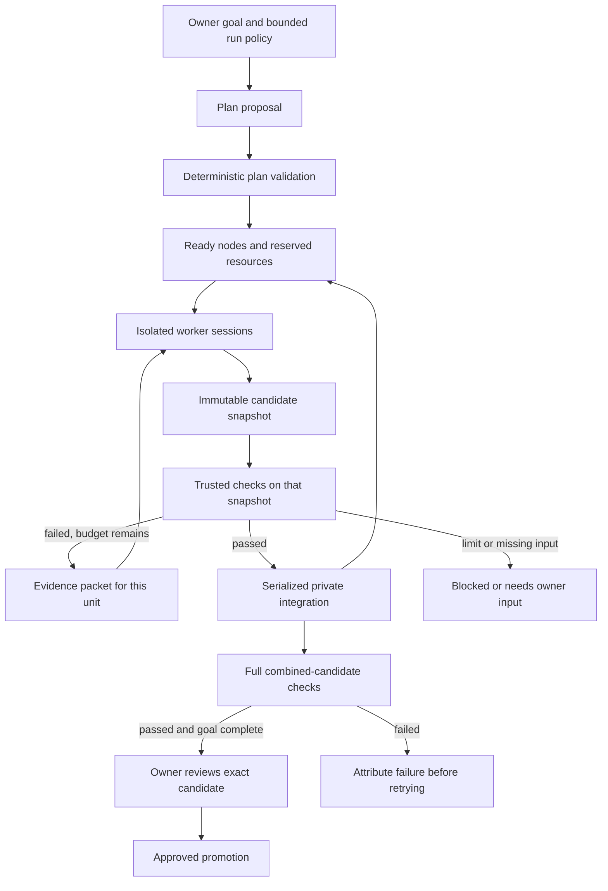

# RFD 0002: Verified agent graphs with one final review

State: discussion
Authors: Ludo, sol  ·  Started: 2026-11-10

## Problem

We can run several agents in Axel, but the owner still coordinates their work:
which tasks can run together, whose changes another task needs, which result is
actually ready, and what to do after a failed check. Twenty sessions magnify that
work unless the coordination and verification become reliable software.

The owner supplied Arcos's *Graph Engineering* article as a starting point.
[The source reading](../RESEARCH.md#graph-engineering-2026-11-10) records its
mechanics, the gaps in its printed code, and the limits of its evidence. This RFD
proposes how to adapt the useful parts to Axel. It does not adopt a design, add
public APIs, or authorize an overnight agent run. Commands and records below are
proposals.

The product target is a bounded run that produces one reviewable integration
candidate. The owner reviews that candidate once. Questions, excluded changes,
failed checks, or a changed base can require further input. We should measure
those interventions rather than promise one approval for every possible task.

## Sketch

### Start with the controller

Build a small deterministic graph runtime around Axel's existing session hosts.
A planner proposes work; workers implement it; code controls admission, checks,
retries and integration. A model's completion message is a candidate submission,
not a successful node transition. An optional reviewer can propose findings, which
must be checked; its opinion never substitutes for the required acceptance gates.

Start with one repository, one controller environment and two concurrent workers.
Use a handwritten plan for the first experiment. Add a planner after the runtime
survives failed checks and controller restarts. Twenty nodes can queue behind a
small concurrency limit; twenty simultaneous model calls are a later experiment.



The feedback arrow returns to one unit. A combined failure can involve several
units, so attribution must allow a dependency group or a revised plan. We should
not automatically blame whichever unit happened to merge last.

### Reuse the current foundations

Reviewed against main after `e79414e`, the multi-select question change.

| Existing piece | Use in a graph | Missing work |
|---|---|---|
| [Threads and parent relationships](../adr/0006-threads-are-the-primitive.md) | Parent thread for the goal; child thread per unit using `subagent` | Run/node projections and run-level aggregation |
| [Managed launch and worktrees](../../crates/axel/src/cmd/launch.rs) | Fresh worker context in a specific checkout | Pin the checkout to the run base and accepted dependency revisions |
| [ACP host](../../crates/axel-acp/src/host.rs) and [socket commands](../../crates/axel-acp/src/socket.rs) | Prompt, observe, interrupt and stop workers through structured protocols | Candidate-submission and controller lifecycle integration |
| [Turn checkpoints](../../crates/axel-acp/src/checkpoint.rs) | Content snapshots, diffs and recovery evidence | A required snapshot for graph acceptance; UI checkpoints are currently best-effort |
| [Signed event store](../../crates/axel-store/src/log.rs) | Auditable plan revisions, results and owner approvals | New event contracts; a local transactional controller lease |
| [Reach, modes and budgets](../../crates/axel-store/src/policy.rs) | Keep existing identity and delegation restrictions | Run-wide reservations, deadlines and admission accounting |
| [Usage reconciliation](../../crates/axel/src/cmd/usage/native.rs) | Count native requests once across attempts | Aggregate distinct run sessions, excluding unrelated work by the same agent |
| [Diff reading](../../crates/axel-tui/src/diff/native.rs) and question popups | Review exact changes; collect genuine missing decisions | A run summary and a typed candidate-approval action |

An agent is a profile and identity, not a process. We do not need twenty new named
agents. We need independently scoped sessions using the chosen profiles.

A run is an execution record belonging to a thread, not a replacement for the
thread primitive. Workers should use separate child threads. Putting every worker
on one thread would feed their messages into Axel's normal catch-up context and
undermine the intended separation. Each worker gets the shared decisions and its
input artifacts, with relevant full traces available for inspection.

### A run contract

Every run pins these inputs before dispatch:

- Repository identity and committed base revision. The planner reads that base,
  not the owner's possibly dirty working directory.
- A versioned goal and shared brief: behavior, interfaces, conventions and
  acceptance criteria that all workers must honor.
- Node IDs, write ownership, required checks, expected output artifacts and
  dependency edges. Each data edge names the artifact it consumes.
- Owner-controlled policy and check definitions, identified by digest. Policy
  supplies the mandatory check set; the planner can add checks but cannot weaken
  that minimum.
- Allowed agent profiles with resolved model/harness versions, maximum concurrency,
  retry limits, deadline and an
  explicit spending allowance or other operator-set resource limits.

Profile snapshots make execution explainable, but a later owner revocation must
still narrow or stop work. The effective authority is the intersection of the
run's grant and current owner policy, never a stale grant that overrides a stop.

Use the committed base by default, leaving local changes alone. Including local
uncommitted changes would be a separate, explicit snapshot choice. A graph must
not quietly include unrelated edits in its final candidate.

A small fixture plan could look like this. These paths and artifacts are an
illustrative test repository, not a plan to execute against Axel:

```yaml
version: 1
base: <commit-oid>
policy: <owner-policy-digest>
limits:
  workers: 2
  repair_attempts: 3
  deadline: <explicit-deadline>
  spend: <owner-set-allowance>
units:
  - id: normalize
    task: Implement the agreed normalization contract
    writes: [src/normalize.rs]
    checks: [normalization-contract]
    outputs: [normalization-v1]
  - id: parse
    task: Implement the agreed parser contract
    writes: [src/parse.rs]
    checks: [parser-contract]
    outputs: [parsed-document-v1]
  - id: render
    task: Render parsed documents with the agreed normalization
    writes: [src/render.rs]
    checks: [renderer-contract]
    needs:
      - unit: normalize
        artifact: normalization-v1
      - unit: parse
        artifact: parsed-document-v1
```

Shared interfaces, module declarations and the independent contract-test harness
must already exist in the fixture base. Otherwise these apparently separate units
would all need to edit the same scaffolding. The planner must combine tightly
coupled work instead of manufacturing parallelism by splitting it into roles.

Validation rejects unknown or duplicate IDs, path escapes, dependency cycles,
missing artifacts, unsupported check IDs and overlapping write sets. The initial
version should require exact write paths, including planned new files. More
flexible glob ownership needs a defined overlap rule before it is useful.

Data dependencies and resource contention are different. An input artifact earns
a data edge. A shared test database, compiler cache or port earns a resource lease.
Neither should be disguised as the other merely to fit the manifest.

### State and durable recovery

| Record | Important fields |
|---|---|
| Run | Parent thread, immutable plan revision, base, policy/check digests, owner authority, controller environment, state, limits |
| Unit | Child thread, declared inputs/outputs, ownership, dependencies, current generation, state |
| Attempt | Unit/generation, session and turn references, exact input revisions, worktree, candidate commit/tree, checks, usage, failure class |
| Artifact | Producer attempt, logical name/schema, source revision, file or report content digest, verification evidence |
| Check result | Candidate tree, dependency revisions, verifier digest, command arguments, exit status, toolchain/environment identity, log artifact digest |
| Approval | Owner identity, plan revision, base, candidate revision and verified report digest |

Proposed unit progression:

```text
waiting -> ready -> running -> checking -> accepted
                      |           |
                      |           +-> repairable -> ready, if budget remains
                      +-> needs_input / failed / cancelled
```

A run can be running, paused, blocked, checking integration, ready for review,
approved, failed or cancelled. An owner pause remains paused until the owner
resumes it. An owner kill or removal is a cancellation, not a crash that the
scheduler should immediately undo by relaunching the worker. A mandatory held or
failed node prevents a claim that the goal is done.

Persist transitions before their side effects, and reconcile afterwards. Give each
launch an idempotency key and each attempt a generation. After a controller crash,
probe existing sessions through ACP/socket status and reconcile recorded Git
artifacts before launching anything again. Reject results from superseded attempt
generations. If a launch outcome is unknown, do not guess that it failed and start
a second billable session.

Pin a run to one controller environment in the MVP. A replicated event log alone
does not provide an exclusive distributed scheduler lease. A local database
transaction can claim that lease; every admission, accepted result and promotion
must check its fencing generation so an old controller cannot keep acting after
takeover. Always-on operation needs an explicit
long-lived supervisor process. It must not depend on the review pane remaining
open, and a sleeping or offline machine cannot promise overnight progress.

### Dispatch, verify and integrate

1. Validate the immutable plan and policy before starting a worker. Record baseline
   repository health first. Keep expected failures of new goal-contract tests
   separate from unrelated pre-existing failures; do not send those failures to a
   random unit as a repair request.
2. Atomically reserve model/process capacity and budget for a ready attempt.
3. Materialize a worktree from the base plus the exact accepted dependency closure.
   Do not use whatever mutable integration HEAD happens to contain at launch time.
4. Launch a managed worker through Axel with its scoped brief and artifact inputs.
   The controller acts under the owner's bounded run authority. A read-only
   planner must not bypass the existing rule that an agent cannot summon a worker
   in a broader runtime mode than its own.
5. Treat a completed turn as a request for verification. Quiesce or stop the worker
   and tracked child jobs before capture; a background writer is not a finished
   unit. Capture the candidate and
   inspect all changes against the immutable assigned base: staged, unstaged,
   untracked, deleted, renamed and already committed changes. Comparing only with
   current HEAD lets a local commit hide changes.
6. Evaluate scope and lane rules against actual paths. Store a candidate revision
   before running checks. A missing or timed-out snapshot is not a green result.
7. Run trusted checks in a separate clean verification checkout of that candidate.
   Bind the verdict to its exact tree, inputs and verifier revision. Tests running
   against a still-changing worker directory are not durable evidence.
8. On failure, record a class and send only the affected unit an evidence packet:
   candidate, failed check, relevant log excerpt, allowed paths and remaining limits.
   Check commands come from the trusted registry, not from model-produced text.
9. On success, accept the candidate and unblock its consumers immediately. Avoid a
   whole-wave barrier when an unrelated slow unit has no bearing on a ready child.
10. Serialize integration into a private, run-specific branch or ref. Check every
    Git exit status. Preserve failed candidates and report conflicts; do not ask a
    model to silently resolve a conflict and retain the old green verdict.
11. Run the complete goal checks and repository checks on the combined candidate.
    For Axel, the baseline includes locked offline workspace tests and strict
    workspace Clippy. Individually green units can still fail together.
12. Produce a report tied to the final candidate. An owner approval authorizes only
    that candidate and base. A changed base, tree, check definition or plan
    invalidates the relevant results and approval.

No terminal typing drives the workers. Hooks, ACP, socket replies and stored events
supply their state. Polling a structured store is acceptable; scraping terminal
prose for a green word is not.

The worker's candidate tests can add evidence, but cannot replace trusted checks.
For the first fixture, keep independent contract tests outside worker write scope.
For Axel's real inline Rust tests, preserving the original test inventory and
identifying changed assertions needs a spike. A worker-editable test suite is not
an independent gate merely because the command exits zero. Changes to check
configuration, baseline assertions or dependencies require the policy's review
path. Do not pretend an automatic diff rule proves all test changes harmless.

### Owner policy and the final review

| Lane | Proposed initial treatment |
|---|---|
| Open | Bounded source changes eligible for unattended execution and private staging after checks |
| Gated | Require explicit preauthorization for the scope and checks, otherwise park; a retry count is evidence, not an authority grant |
| Closed | Production mutations, destructive data operations and other excluded capabilities stay outside the unattended MVP |

Classification uses actual changes and known impact rules, not model confidence
or only the planner's declared glob strings. Applying a migration is different
from generating a migration file. A Git review gate does not control side effects
that a worker or test command has already performed.

Worktrees isolate checkouts, not operating-system permissions. Axel's current
policy module explicitly guards runaway agents rather than hostile ones: harnesses
run as the owner's user. Trusted controller code and an immutable verifier remove
accidental self-grading paths. They do not create a security sandbox. Before using
untrusted repositories or granting sensitive external credentials, the execution
environment needs an enforceable isolation boundary. That is a separate capability
requirement, not a promise supplied by an `AGENTS.md` instruction.

For a successful, fully eligible run, the owner sees one final review containing:

- Completed and incomplete units, with reasons and dependent work affected.
- The combined diff and links to each unit's checks and artifacts.
- Actual usage, outstanding reservations, retries and elapsed time.
- Goal-level verification and any test or policy changes requiring attention.

Promotion should first produce a private branch or draft PR. Final merge remains
an owner action tied to the verified revision, subject to normal branch protection
and CI. If the target branch advances, recompose and recheck. Do not rewrite the
owner's working tree or reset a shared integration branch to make the run fit.
Generating and approving a patch does not authorize a subsequent deployment.

A later multi-repository run would prepare a bundle of repository/base/candidate
triples and validate the complete bundle before approval. Promotion needs a durable
journal and compare-and-swap checks for each target. Failure after one repository
advances produces an explicit partial state; Git cannot make that sequence atomic,
and an automatic rollback could undo work already consumed elsewhere.

### Budgets, failures and learning

Use one controller-owned repair budget, initially three attempts per unit. Define
an attempt as a candidate/check/repair cycle. Do not multiply hidden Stop-hook
retries by outer process retries and call that a three-attempt limit. Separate
infrastructure failures from behavioral failures, with their own bounded retry
policy and evidence. Unknown failure causes stop or escalate rather than trigger
an unlimited repair loop. A verified no-op is a possible result; requiring an edit
when the goal is already satisfied encourages pointless changes.

Admission must reserve capacity before launching parallel workers. Existing daily
spend checks alone do not prevent several concurrent launches from all seeing the
same remaining budget. Keep run usage separate from the agent's unrelated work,
and count a session reused for repairs once. Account for provider rate limits,
local CPU/RAM, and check-process capacity separately from model concurrency.

Dollar usage is an estimate and arrives with delay. Reservations and cancellation
reduce overshoot but are not a guarantee of an exact provider billing ceiling.
Report the lag and observed overshoot. A provider-enforced token limit, where
available, is stronger than a local display total.

Append failure evidence to a run journal. Generate proposed planning lessons from
repeated, classified failures, but do not automatically turn two similar log lines
into a hard rule. Keep planning hints separate from execution permissions, budgets
and checker definitions. An owner-reviewed lesson can influence the next plan;
a worker must not expand its authority by editing shared memory.

### Terminal UI and code ownership

The parent thread gets a run view: node states, dependencies, blockers, usage and
links to existing child-thread and diff views. Ordinary progress stays in the
message stream. Genuine owner questions use the question popup. A final review
opens the combined candidate, not twenty unrelated completion messages.

A proposed CLI could be `axel graph plan`, `run`, `status`, `pause`, `cancel`,
`retry` and `review`. These commands do not exist yet. Plan submission and final
approval should have distinct typed operations; an agent's message claiming the
owner approved something must never substitute for an owner approval event.

A possible implementation split is:

- `axel-store`: graph records, signed facts and local leases/reservations.
- `axel-graph`: deterministic validation, scheduling, reconciliation and acceptance.
- `axel-acp`: existing worker lifecycle, plus structured candidate notifications.
- `axel`: supervision, Git/worktree and checker process adapters, CLI/MCP entry points.
- `axel-tui`: plan/run/review views using the existing terminal primitives.

Settle these boundaries and record an ADR before changing the public contracts.
No model call belongs in the scheduling or acceptance code.

## First experiment and acceptance criteria

| Stage | Deliverable | Evidence required before advancing |
|---|---|---|
| 0. Replay fixture | Handwritten three-node plan, fake ACP workers, protected contract tests | Reject invalid plans; reproduce the final tree; inject scope violations, duplicate delivery, worker death, checker failure and controller restart |
| 1. Small real run | One repo, two workers, explicit limits, one private integration candidate | Failure returns only to its unit; dependency snapshots are pinned; no edits escape the declared scope; owner tree remains untouched |
| 2. Planner and review | A planner proposes validated plans; owner reviews one combined candidate | Planner cannot weaken policy/checks; combined checks catch two individually green but incompatible units; changed base invalidates approval |
| 3. Throughput experiment | Repeat representative tasks with concurrency 1, 2 and 4; later 8 and 20 only if useful | Same acceptance gates and task set, measured resource use, review burden and escaped defects; no duplicate launches after restart |
| 4. Wider scope | Reviewed planning memory, then consider multiple repositories/environments | Evidence that the earlier stages improve outcomes; an explicit recovery design for partial cross-repo promotion |

The replay fixture should include both legacy cumulative usage and request-ledger
mirrors, so controller accounting does not reintroduce the cost duplication we
just corrected. Use immutable tree identity when testing reproducibility; commit
timestamps can differ even when content is identical.

Compare against the same work run sequentially. Measure end-to-end time including
checks and owner review, accepted work per estimated dollar, escaped regressions,
repair causes, blocked time and peak resource use. Record all owner interventions,
including questions, manual restarts, plan edits and conflict resolution. Also
record review minutes and requested changes: one large approval can hide a large
review burden. Keep repeat failures grouped by evidence and class, not just an
LLM-written description.

## Open questions

| Question | How we find out |
|---|---|
| Which Axel tasks separate cleanly enough to benefit? | Review recent changes and try the same bounded tasks sequentially and in the fixture graph; keep coupled cross-crate changes together |
| How do we protect meaningful checks in a real Rust workspace? | Spike an external contract harness and baseline test inventory, including a candidate that deletes or weakens its own tests |
| How much extra isolation do our intended repositories need? | Write the trusted-repo threat model and test the available harness/environment boundaries before expanding permissions |
| What happens when accepted dependencies change? | Exercise generation invalidation and dependent retries against pinned old artifacts; never reuse a stale green result |
| What budget and concurrency are useful on the owner's account and hardware? | Start with explicit operator limits and measure native usage, rate-limit waits, compiler contention and cancellation lag |
| Which actions belong in the final approval? | Prototype the run report with an open-only run, a mandatory gated node and a changed base; count the actual owner interventions |
| How should cross-repo promotion work? | Model a failure after the first repository advances; Git has no atomic multi-repository merge, so require a journal and an explicit partial state |

## Risks

A green gate proves only its stated conditions. Missing product requirements and
shared assumptions still need a good brief and final human review. Narrow file
ownership can serialize useful work or create awkward cuts; twenty workers may
be slower and more expensive than four. Native process and usage recovery can lag
or fail, and current worktree/guard isolation is not an adversarial boundary.
These are things to measure in the fixture and pilot, not reasons to launch a
large overnight batch before the controller exists.

## What we learned

- 2026-11-10: read all 23 PDF pages and inspected the printed checker and runner.
  The source's scheduler pattern is useful; its sample is not a sufficient
  unattended acceptance system. Primary references support the patterns, but
  research-task performance numbers do not establish coding throughput.
- 2026-11-10: Axel already has the worker execution and review primitives. The
  missing center is a durable, bounded controller with independently verified
  candidates. Start with the three-node replay fixture before adding a planner.

## References

- [Source reading and primary references](../RESEARCH.md#graph-engineering-2026-11-10).
- [Current design](../DESIGN.md), [public contracts](../CONTRACTS.md).
- [Structured signals](../adr/0003-structured-signals-never-scraping.md),
  [signed log](../adr/0005-signed-event-log-local-first.md),
  [threads as the primitive](../adr/0006-threads-are-the-primitive.md),
  [autopilot guard](../adr/0008-autopilot-with-a-guard.md).
